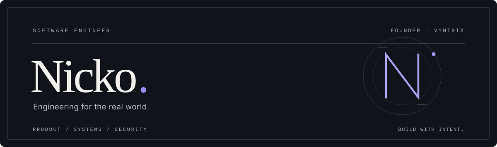

  

 

### Software, with intention.

I'm **Nicko** — a software engineer and founder of **[VYNTRIX](https://github.com/VYNTRIX-SOFTWARE)**.

I work at the intersection of **product engineering**, **system reliability**, and **security**. I value clear trade-offs, thoughtful architecture, and software that stays dependable beyond its first release.

---

### Selected open source

**[Averact](https://github.com/VYNTRIX-SOFTWARE/Averact)**  
Action contracts and execution verification for AI-initiated operations.

**[NusaRiksa](https://github.com/VYNTRIX-SOFTWARE/Nusariksa)**  
Self-hosted IT governance, risk, and security workflows for Indonesian rural banks.

---

### Tools I work with

  
  &nbsp;&nbsp;
  
  &nbsp;&nbsp;
  
  &nbsp;&nbsp;
  
  &nbsp;&nbsp;
  
  &nbsp;&nbsp;
  
  &nbsp;&nbsp;
  
  &nbsp;&nbsp;
  

